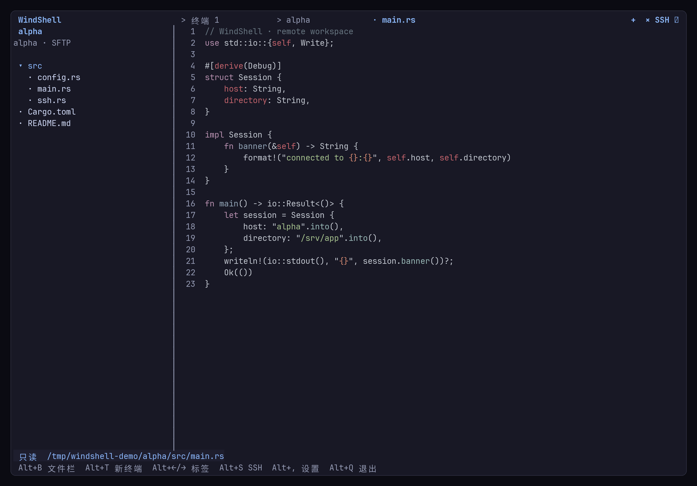
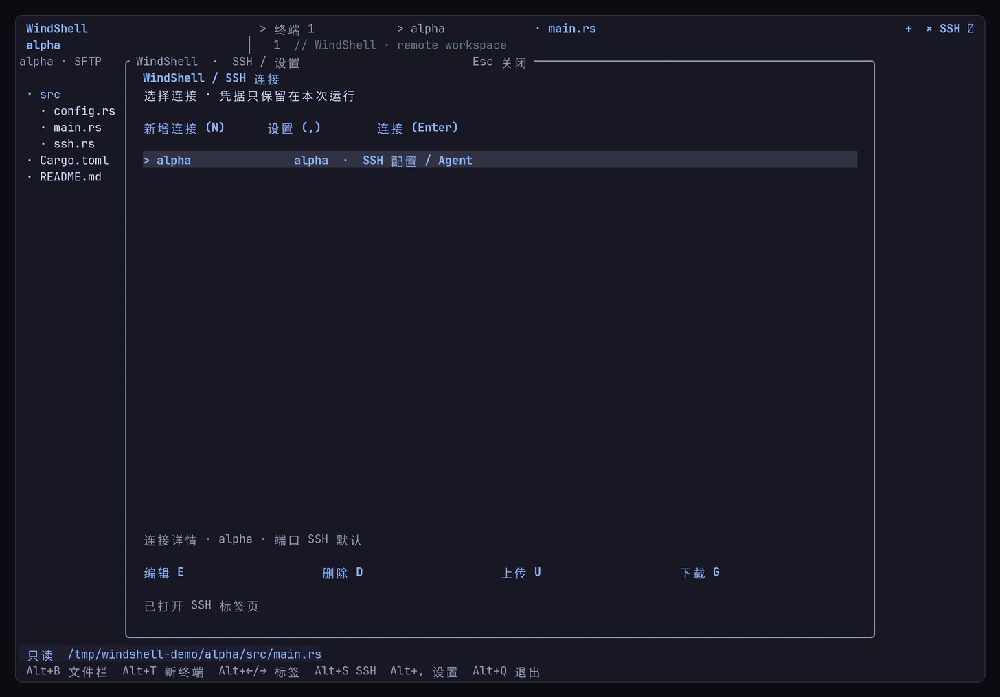
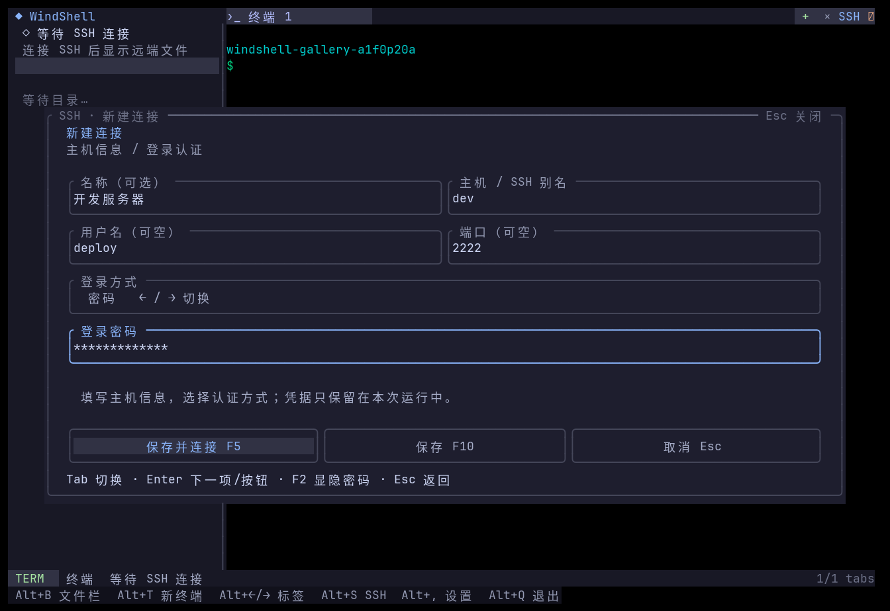
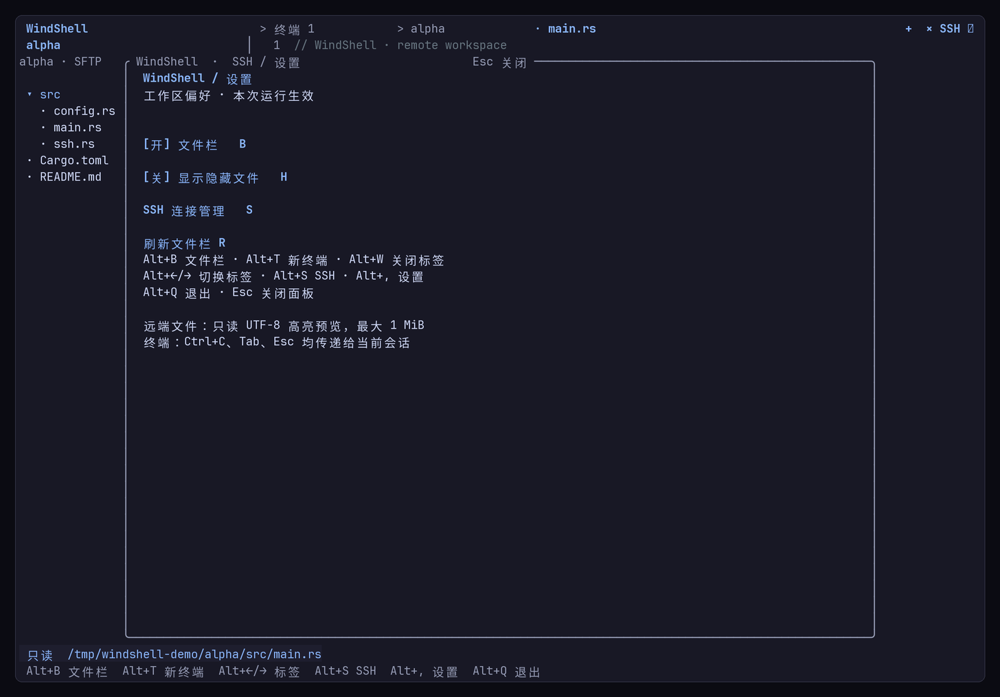

<p align="center">
  
</p>

<h1 align="center">WindShell</h1>

<p align="center">
  <strong>面向 SSH 的 Rust 终端工作区 — 远端文件树、本地/SSH 终端与只读预览</strong>
</p>

<p align="center">
  <a href="https://github.com/tingfeng347/windshell/actions/workflows/ci.yml"></a>
  <a href="Cargo.toml"></a>
  <a href="README.md#启动"></a>
  
  <a href="LICENSE"></a>
</p>

WindShell 是一个用 Rust 编写的终端 SSH 工作区：左侧展开**当前 SSH 会话的远端文件树**，右侧在**本地终端、SSH 终端和文件预览**之间切换，连接管理与设置收在浮动面板里。界面参考 [WindVim](https://github.com/tingfeng347/windvim) 的终端工作流，但服务对象是远端服务器。

它不模拟终端，也不自研 SSH。会话交给系统 OpenSSH，远端浏览通过 SFTP 复用同一条已认证连接，因此密钥、Agent、`known_hosts` 与主机指纹校验都保持你熟悉的行为。

## 特性

- **远端文件栏**：连接后从远端登录目录展开目录树，按扩展名或 shebang 做只读高亮预览；重复打开同一文件回到已有标签。
- **多标签终端**：本地 shell 与 SSH PTY 标签并存，切换标签时后台继续运行；Ctrl+C、Tab、Esc 原样交给当前会话。
- **三种登录方式**：SSH 配置 / Agent、密码、整段粘贴私钥（含口令）。凭据只驻留本次运行，不写入连接配置。
- **显式信任主机**：首次连接在 TUI 中展示指纹，默认取消；核对后选择「信任并继续」，主机密钥变化仍由 OpenSSH 拒绝。
- **文件传输**：在 SSH 面板中按 U / G 上传或下载，路径按原文处理，进度由前台 OpenSSH 显示。
- **为小终端设计**：48×18 起可用，表单随焦点滚动，鼠标点击与键盘操作等价。



截图来自真实本地 sshd + SFTP 会话，未拼接界面。

## 连接与认证

按 `Alt+S` 或点击顶部 **SSH** 打开管理面板，按 `N` 或点击「新增连接」。主机可以填 IP、域名，也可以直接填 `~/.ssh/config` 中的 Host 别名；名称可空，用户名和端口留空时继承 OpenSSH 设置。

| 登录方式 | 行为 |
| --- | --- |
| SSH 配置 / Agent | 使用已有 SSH config、系统密钥和 Agent，WindShell 不接触私钥 |
| 密码 | 在遮挡的输入框中输入，通过 askpass 桥接给 OpenSSH，不落盘 |
| 粘贴私钥 | 整段粘贴 `BEGIN / END` 私钥，内容始终隐藏，只显示行数；加密私钥可填口令或连接时再输入 |

`Tab` 切换字段，登录方式上用 `←` / `→` 或空格切换。使用终端的粘贴菜单/快捷键（通常 `Ctrl+Shift+V`）粘贴多行私钥，终端需支持 bracketed paste；`F2` 显隐密码或口令。





「保存并连接」或 `F5` 开始连接，「保存」或 `F10` 只写配置。也可以先不填凭据，等连接时再输入。**密码、粘贴私钥和口令只保留在本次运行中，重启后重新输入。**

## 安装

需要 Rust stable 和 PATH 中的 **OpenSSH 9+**（`ssh`、`scp`；远端浏览还需要服务器启用 SFTP）。在支持 UTF-8 和 ANSI 的交互终端中运行：

```bash
git clone https://github.com/tingfeng347/windshell.git
cd windshell

# 开发运行
cargo run -p windshell --release

# 或安装到 ~/.cargo/bin
cargo install --path crates/windshell-tui
windshell
```

也可以直接用 release 二进制：

```bash
cargo build -p windshell --release
./target/release/windshell
```

Linux 默认配置为 `~/.config/windshell/hosts.toml`，macOS 为 `~/Library/Application Support/windshell/hosts.toml`，Windows 为 `%APPDATA%\windshell\config\hosts.toml`，具体位置遵循 `directories` 的平台规则。

## 启动

```bash
# 默认连接列表
windshell

# 独立连接列表与独立 OpenSSH 配置
windshell --config ./hosts.toml --ssh-config ./ssh_config

# 仅校验连接列表，不打开界面
windshell --config ./hosts.toml --check
```

启动即打开本地 shell。SSH 连接打开独立 PTY 标签；远端 `exit` 后保留末屏，`Alt+W` 关闭。行首输入 OpenSSH 的 `~.` 可断开无响应会话。

## 操作

| 按键 | 操作 |
| --- | --- |
| `Alt+B` / 点击 WindShell | 展开/收起文件栏并聚焦 |
| `Alt+T` / 顶部 `+` | 新建本地终端标签 |
| `Alt+←` / `Alt+→` | 切换终端或文件标签 |
| `Alt+W` / 顶部 `×` | 关闭当前标签（终止对应会话） |
| `Alt+S` / `Alt+,` | SSH 管理 / 设置面板 |
| `Alt+Q` | 退出工作区 |
| `Shift+PageUp/PageDown` / 滚轮 | 滚动终端历史或文件预览 |
| `↑↓` / `J K`（文件栏） | 选择文件；`Enter`/`→` 展开或打开，`←` 收起，`R` 刷新 |
| `↑↓` / `J K`（SSH 面板） | 选择主机 |
| `N` / `E` / `D` | 新建 / 编辑 / 删除连接 |
| `Enter`（主机列表） | 连接 |
| `U` / `G` | 上传 / 下载文件 |
| `Tab` / `Shift+Tab` / `↑↓`（表单） | 切换字段或按钮 |
| `Enter`（表单字段） | 前进到下一项；聚焦按钮时执行操作 |
| `←→` / `Home` / `End` / `Delete` / `Backspace` | 编辑文本 |
| `Ctrl+U` | 清空当前字段 |
| `F5` | 保存并连接 / 继续认证 / 开始传输 |
| `F10`（连接表单） | 只保存 |
| `F2` | 显隐密码/口令 |
| `Esc` | 取消并返回 |
| `Q`（SSH 面板） | 退出 |

支持鼠标点击主机、字段、认证方式和操作按钮。文件栏中 `Backspace` 返回上级目录，`R` 刷新。设置面板可切换文件栏和隐藏文件，本次运行有效。



## 文件与传输

文件栏只显示当前 SSH 会话的远端文件：连接后从远端登录目录开始，切换 SSH 或文件标签会切换到所属会话的目录树。本地终端标签显示连接提示，不浏览本地文件。目录点击展开/收起，文件点击在右侧只读预览（UTF-8、最大 1 MiB），根据扩展名或 shebang 自动语法高亮，未知类型按纯文本显示。二进制、大文件、权限不足或连接断开都会在预览区提示。

远端浏览通过 SFTP，复用当前 OpenSSH 认证连接，每次操作后关闭文件通道，不往终端注入命令。该功能依赖 Unix OpenSSH 的 ControlMaster：**Linux 已实测，macOS 未实测，Windows 暂不支持远端浏览**。

在 SSH 管理面板中按 `U` 上传、`G` 下载，输入本地与远端路径后点击「开始传输」或按 `F5`。路径无需额外加引号，空格按原文处理；远端路径相对于远端登录目录。暂不支持目录递归、通配符、远端反斜杠或 `~` 前缀。**目标已存在时会覆盖**；`Ctrl+C` 可取消传输，可能留下部分文件。

## 配置与凭据

```toml
[[hosts]]
name = "开发服务器"
address = "dev"
user = "deploy"
port = 22
# auto / password / private_key；仅记录认证方式，不记录凭据
authentication = "password"
```

旧版 `identity` 配置仍由 Auto 模式使用，界面不再要求填写密钥路径。用户 SSH 配置应可信。

为了让系统 OpenSSH 使用粘贴私钥，运行期间会创建私有临时文件（Unix 0600），会话/传输正常结束、取消或普通错误后删除。密码和口令不写临时文件。强制杀死进程或系统崩溃可能留下临时私钥文件；本版本不提供持久凭据库，也不绕过主机校验。

## 开发与测试

```bash
cargo fmt --all --check
cargo clippy --locked --workspace --all-targets -- -D warnings
cargo test --locked --workspace
cargo build -p windshell

# 可选：真实 sshd 回归，需 tmux、sshd、ssh-keygen
python3 tests/workspace_smoke.py
python3 tests/remote_smoke.py
python3 tests/ssh_smoke.py

# 可选：密码/私钥/指纹交互，需 tmux、ssh-keygen 和 tests/requirements.txt
python3 tests/auth_smoke.py
```

- `windshell-core`：配置、运行时凭据、OpenSSH 操作及认证请求回调，无 TUI 依赖。
- `windshell`：Ratatui / Crossterm 界面、输入编辑和终端生命周期。
- [规格入口](spec/README.md)与[工作区验收](spec/06-modules/workspace/spec.md)：实际验证范围与限制。

CI 覆盖 Linux / macOS / Windows 构建与测试；跨平台运行时认证仍需各平台实测，实际结论以验收记录为准。

## 文档

- [规格入口](spec/README.md)
- [MVP 范围](spec/06-modules/mvp/spec.md)
- [认证流程](spec/06-modules/auth/spec.md)
- [工作区交互](spec/06-modules/workspace/spec.md)
- [决策记录](decisions.tsv)

## 许可

[MIT](LICENSE)。图标与界面使用 [Catppuccin](https://github.com/catppuccin/catppuccin) 配色，视觉语言参考 [WindVim](https://github.com/tingfeng347/windvim)。